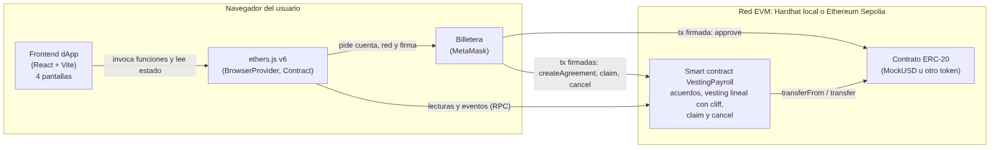
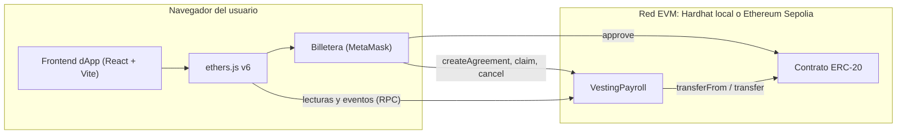
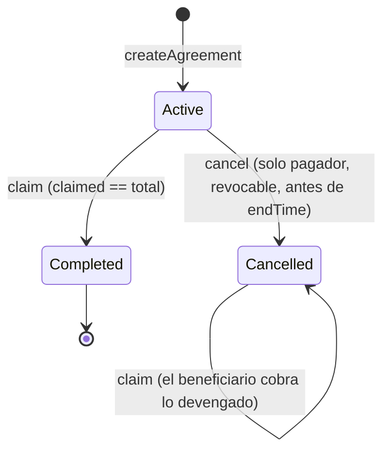

# Documento de arquitectura

Obligatorio Blockchain 2026 — dApp de pagos de sueldo / vesting lineal en ERC-20.

## 1. Diagrama de componentes



Componentes principales y cómo se relacionan:

| Componente | Responsabilidad |
|---|---|
| **Frontend dApp** (React + Vite) | Las 4 pantallas (Crear acuerdo, Acuerdos creados, Mis ingresos, Detalle) y el estado de las transacciones. Usa la hora de la cadena para las fechas y los avisos. No tiene backend propio. |
| **ethers.js v6** | Biblioteca de conexión Web3: crea el proveedor a partir de la billetera, instancia los contratos con su ABI, lee estado y eventos. |
| **Billetera (MetaMask)** | Guarda las claves, informa cuenta y red conectadas y firma cada transacción. |
| **VestingPayroll** | Smart contract que gestiona los acuerdos: guarda los fondos y aplica las reglas de creación, vesting, reclamo y cancelación. |
| **Contrato ERC-20** | Token con el que se paga. `VestingPayroll` lo recibe con `transferFrom` y lo entrega con `transfer`. |

La dApp funciona sobre dos redes y elige los contratos según la red de la billetera: Hardhat local (para desarrollo y pruebas) y Ethereum Sepolia (despliegue público).

<details>
<summary>Fuente del diagrama (Mermaid)</summary>



</details>

Flujo de fondos:

1. El pagador hace `approve(VestingPayroll, total)` sobre el token.
2. `createAgreement` ejecuta `transferFrom(pagador → contrato, total)`: el acuerdo queda **fondeado de antemano**.
3. El beneficiario llama `claim` y el contrato le transfiere lo devengado.
4. Si el acuerdo es revocable, el pagador puede llamar `cancel`: lo devengado queda para el beneficiario y lo restante vuelve al pagador.

El frontend no tiene backend propio: lee el estado y los eventos directamente del RPC y envía las transacciones a través de la billetera.

## 2. Responsabilidades de cada contrato

| Contrato | Responsabilidad |
|---|---|
| `VestingPayroll` | Único contrato de negocio. Custodia los tokens, guarda los acuerdos, calcula el devengo y aplica las reglas de quién puede crear, reclamar y cancelar. No tiene dueño, ni funciones administrativas, ni upgrades: nadie puede tocar los fondos fuera de las reglas. |
| Token ERC-20 (externo) | El contrato opera con cualquier ERC-20 estándar vía `IERC20` y `SafeERC20`. No se asume ningún token en particular. |
| `mocks/MockUSD` | Token de prueba de 6 decimales con `mint` público. Solo para desarrollo y tests. |
| `mocks/FeeOnTransferToken` | Token que quema 1 % en cada transferencia. Prueba que el contrato rechaza tokens que lo dejarían sub-fondeado. |
| `mocks/ReentrantToken` + `ReentrantBeneficiary` | Simulan un ataque de reentrancia durante `claim` para comprobar que no se puede cobrar dos veces. |

Herencia: `VestingPayroll is ReentrancyGuard` (OpenZeppelin 5.6.1).

## 3. Estructura de un acuerdo

```solidity
struct Agreement {
    address payer;        // slot 0
    uint40  startTime;    // slot 0
    uint40  endTime;      // slot 0
    bool    revocable;    // slot 0
    Status  status;       // slot 0
    address beneficiary;  // slot 1
    uint40  cancelledAt;  // slot 1  (0 mientras no se cancele)
    uint40  cliffTime;    // slot 1  (en [startTime, endTime]; igual a startTime = sin cliff)
    IERC20  token;        // slot 2
    uint128 totalAmount;  // slot 3
    uint128 claimedAmount;// slot 3
}
mapping(uint256 id => Agreement) private _agreements;
uint256 public agreementCount;   // los ids arrancan en 1
```

- El id es un contador incremental; el id 0 nunca existe, por lo que `payer == address(0)` identifica un acuerdo inexistente.
- `cliffTime` es una fecha absoluta. Es opcional: pasando `startTime` el acuerdo queda sin cliff. Se valida que esté en `[startTime, endTime]` (`InvalidCliff`).
- `totalAmount` y `claimedAmount` son `uint128`: alcanzan para cualquier token real y permiten empaquetar ambos en un solo slot.
- No hay arrays por usuario. Para listar «mis acuerdos» el frontend lee los eventos `AgreementCreated`, que tienen `payer` y `beneficiary` indexados (ver sección 10).

## 4. Máquina de estados



| Estado | Cómo se llega | Qué se puede hacer |
|---|---|---|
| `Active` | Al crear | `claim` (beneficiario), `cancel` (pagador, si es revocable y no terminó) |
| `Completed` | El `claim` que deja `claimed == total` | Nada: `claim` revierte con `NothingToClaim`, `cancel` con `NotActive` |
| `Cancelled` | `cancel` | `claim` hasta agotar lo devengado al momento de cancelar; `cancel` revierte con `NotActive` |

Un acuerdo `Cancelled` se queda en ese estado aunque el beneficiario cobre todo lo devengado; no pasa a `Completed`.

El tiempo por sí solo no cambia el estado: pasado `endTime` el acuerdo sigue `Active` hasta que el beneficiario cobra el total con `claim`, y recién ahí pasa a `Completed`. En ese lapso ya no se puede cancelar (`AlreadyEnded`), y la dApp lo muestra como «Finalizado (pendiente de cobro)».

## 5. Fórmula de vesting

```
vested(t) = 0                                   si t <= startTime  o  t < cliffTime
          = totalAmount                         si t >= endTime
          = totalAmount * (t - start) / (end - start)   en otro caso
claimable(t) = vested(t) - claimedAmount
```

- **Multiplicar antes de dividir** para no perder precisión. Se hace en `uint256`, así que `uint128 * uint40` nunca desborda.
- **Redondeo hacia abajo**: el contrato nunca devenga de más. En `t >= endTime` devuelve exactamente `totalAmount`, por lo que no queda polvo atrapado.
- **Cliff**: antes de `cliffTime` no se devenga nada. Al llegar al cliff se libera de golpe lo devengado linealmente desde `startTime` y luego sigue lineal (por ejemplo, con un cliff al 40 % del período, en ese instante ya es reclamable el 40 % del total). Si `cliffTime == endTime`, todo se libera recién al final.
- **Cancelación**: si el estado es `Cancelled`, el tiempo se acota a `cancelledAt`; el devengo queda congelado y no sigue creciendo.
- Ejemplo: 10 unidades durante 3 segundos → 3, 6 y 10 unidades (3,33 → 3; 6,67 → 6; al final, 10 exacto).

```solidity
function _vested(Agreement storage a, uint256 timestamp) private view returns (uint128) {
    if (a.status == Status.Cancelled && timestamp > a.cancelledAt) timestamp = a.cancelledAt;
    uint256 start = a.startTime;
    uint256 end = a.endTime;
    if (timestamp <= start || timestamp < a.cliffTime) return 0;
    if (timestamp >= end) return a.totalAmount;
    return uint128((uint256(a.totalAmount) * (timestamp - start)) / (end - start));
}
```

## 6. Decisiones de storage / memory / calldata

**a) Empaquetado del struct en 4 slots (storage).** Ordenamos los campos para que los de menor tamaño compartan slot:

```solidity
address payer; uint40 startTime; uint40 endTime; bool revocable; Status status; // 20+5+5+1+1 = 32 bytes
address beneficiary; uint40 cancelledAt; uint40 cliffTime;                       // 30 bytes
IERC20 token;                                                                    // 20 bytes
uint128 totalAmount; uint128 claimedAmount;                                      // 32 bytes
```

Sin empaquetar serían 11 slots (uno por campo); con el orden elegido son 4. Crear un acuerdo escribe 4 slots en vez de 11 (cada `SSTORE` en un slot nuevo cuesta ~22.100 gas). El `cliffTime` entra en el espacio libre del slot 1, así que agregar el cliff no costó ningún slot extra. En `claim`, `claimedAmount` y `totalAmount` comparten slot, así que se leen y escriben juntos.

**b) `storage` como puntero en `claim` y `cancel`.**

```solidity
Agreement storage a = _load(id);
```

No se copia el struct a memoria: se leen solo los campos que se necesitan (`beneficiary`, `claimedAmount`, `totalAmount`, etc.) y se modifican directamente `a.claimedAmount` y `a.status`. Copiar a `memory` leería los 4 slots completos para usar unos pocos campos, y luego habría que escribir de vuelta.

**c) `memory` solo para lo que sale del contrato.**

```solidity
function getAgreement(uint256 id) external view returns (Agreement memory) { return _load(id); }
```

Una función `view` externa que devuelve el struct completo necesita una copia en memoria para codificar la respuesta ABI. Es una lectura off-chain, sin costo para el usuario.

**d) Variables locales en lugar de relecturas de storage.**

```solidity
uint128 newClaimed = a.claimedAmount + amount;
a.claimedAmount = newClaimed;
if (newClaimed == a.totalAmount && ...) ...
emit Claimed(id, msg.sender, amount, newClaimed);
```

El nuevo total se calcula una vez en una variable local (stack) y se reutiliza para la comparación y el evento, en lugar de volver a leer `a.claimedAmount` (cada `SLOAD` caliente cuesta 100 gas, más el costo de repetirlo).

**e) Calldata.** Las funciones externas reciben solo tipos de valor (`address`, `uint128`, `uint40`, `bool`, `uint256`), que se leen directamente de calldata sin copia. No hay arrays ni `bytes`/`string` como parámetro, por lo que no hace falta declarar `calldata` explícito. Si se agregara el pago en lote opcional (`createAgreements(Params[] calldata items)`), el arreglo iría como `calldata` para evitar copiarlo a memoria.

**f) Sin estructuras de índice en storage.** No se guardan listas de acuerdos por usuario: mantenerlas costaría un `SSTORE` extra (~22.100 gas) por cada alta. Se usan eventos con campos indexados, que cuestan mucho menos y se consultan off-chain.

## 7. Medidas de seguridad

| Riesgo | Mitigación |
|---|---|
| **Reentrancia** | `ReentrancyGuard` (`nonReentrant`) en `createAgreement`, `claim` y `cancel`, además de seguir el orden **checks → effects → interactions**: `claimedAmount` y `status` se actualizan antes de cualquier transferencia. Tests con `ReentrantToken` + `ReentrantBeneficiary`: verifican que la reentrada revierte con `ReentrancyGuardReentrantCall`, también al intentar reclamar otro acuerdo (caso que el orden CEI solo no frena). |
| **Doble cobro** | `claim` paga `vested - claimed` y actualiza `claimed` antes de transferir; un segundo reclamo inmediato revierte con `NothingToClaim`. |
| **Reclamo por un tercero** | Solo `msg.sender == beneficiary` puede reclamar (`NotBeneficiary`). |
| **Cancelación por un tercero / no revocable** | Solo el pagador, solo si `revocable` y `Active`, y nunca después de `endTime` (`NotPayer`, `NotRevocable`, `NotActive`, `AlreadyEnded`). |
| **Tokens que no devuelven `bool` / fallan en silencio** | `SafeERC20` (`safeTransfer`, `safeTransferFrom`). |
| **Fee-on-transfer** (llegaría menos de lo declarado y el acuerdo quedaría sub-fondeado) | Se mide `balanceOf` antes y después de `transferFrom` y se revierte con `UnexpectedTransferAmount` si no coincide. |
| **Overflow / redondeo** | Solidity 0.8 revierte en overflow; los cálculos intermedios usan `uint256`; redondeo hacia abajo; límites probados con `type(uint128).max` y `type(uint40).max`. |
| **Datos inválidos** | `InvalidBeneficiary` (dirección cero), `InvalidToken`, `InvalidAmount`, `InvalidTimeRange`, `InvalidCliff`. |
| **Fondos atrapados por administración** | No hay owner, pausa ni funciones de rescate: el contrato no tiene una puerta trasera, pero tampoco un botón de emergencia (ver limitaciones). |
| **Errores baratos y legibles** | Custom errors con parámetros en lugar de `require` con strings. |

## 8. Eventos definidos

| Evento | Parámetros | Cuándo |
|---|---|---|
| `AgreementCreated` | `id`, `payer`, `beneficiary` (los tres indexados), `token`, `totalAmount`, `startTime`, `cliffTime`, `endTime`, `revocable` | Al crear un acuerdo |
| `Claimed` | `id` (indexed), `beneficiary` (indexed), `amount`, `totalClaimed` | En cada reclamo |
| `AgreementCompleted` | `id` (indexed) | Cuando el reclamo deja `claimed == total` |
| `AgreementCancelled` | `id` (indexed), `payer` (indexed), `vestedAtCancel`, `refunded` | Al cancelar |

El frontend usa `payer` y `beneficiary` indexados para construir «Acuerdos creados» y «Mis ingresos» sin recorrer todos los ids, y los eventos por `id` para el historial de la pantalla de detalle.

## 9. Principales casos de borde

- **Inicio en el pasado:** se permite. Parte del monto queda disponible apenas se crea (útil para pagar sueldos ya devengados). La dApp avisa al usuario, comparando con la hora del último bloque de la cadena (no con la del navegador), que es la que usa el contrato.
- **Fin en el pasado:** también permitido; todo el monto es reclamable de inmediato.
- **`end <= start`:** revierte con `InvalidTimeRange`.
- **Cliff fuera de `[start, end]`:** revierte con `InvalidCliff`. Con `cliff == start` no hay cliff; con `cliff == end` todo se libera al final.
- **Reclamar antes del cliff:** `NothingToClaim`, aunque el vesting ya haya empezado.
- **Cancelar antes del cliff:** el devengado es 0, todo vuelve al pagador y el beneficiario no puede cobrar nada, ni siquiera pasada la fecha del cliff (el devengo queda congelado en `cancelledAt`).
- **Reclamo antes del inicio o sin saldo:** `NothingToClaim`.
- **Reclamo justo en `endTime`:** devuelve exactamente `totalAmount`.
- **Cancelar antes de `startTime`:** devengado 0, se devuelve el total al pagador.
- **Cancelar en `endTime` o después:** `AlreadyEnded` (ya está todo devengado; el beneficiario simplemente cobra).
- **Cancelar dos veces, o cancelar un acuerdo completado:** `NotActive`.
- **Reclamar después de cancelar:** permitido; el beneficiario cobra lo devengado hasta `cancelledAt`, y luego `NothingToClaim`.
- **Redondeo:** con 10 unidades y 3 segundos el devengo es 3, 6, 10. Al cancelar, el redondeo hacia abajo del devengado hace que la unidad fraccionaria favorezca al pagador (diferencia máxima: 1 unidad mínima del token).
- **Montos y fechas en el máximo de su tipo:** no hay overflow (`uint128 * uint40` cabe en `uint256`).
- **Id inexistente (incluido el 0):** `AgreementNotFound`.
- **Beneficiario = pagador:** el contrato lo permite (no hay riesgo para terceros).
- **Beneficiario = el propio contrato:** el contrato lo acepta, pero nadie puede reclamar y lo devengado queda atrapado; solo vuelve lo no devengado si el pagador cancela un acuerdo revocable antes del fin. La dApp lo rechaza antes de enviar (ver limitaciones).
- **Token sin comisión vs. con comisión:** el segundo se rechaza.

## 10. Limitaciones conocidas

- **Sin pausa, sin upgrades ni lotes:** el contrato implementa el vesting lineal con cliff opcional y nada más.
- **Sin recuperación de fondos:** si un token bloquea transferencias (lista negra, pausa) hacia el beneficiario, `claim` revierte y esos fondos quedan en el contrato. Tampoco hay forma de rescatar tokens enviados por error.
- **Beneficiario = el propio contrato:** `createAgreement` solo rechaza la dirección cero. Si el beneficiario es el propio `VestingPayroll`, nadie puede reclamar y lo devengado queda atrapado (hay un test que lo documenta). La dApp lo rechaza, pero una llamada directa al contrato no. No se corrigió porque el contrato ya está desplegado en Sepolia.
- **Código no verificado en Etherscan:** el bytecode desplegado se comparó por RPC con el compilado, pero el código fuente no está publicado ni verificado en el explorador.
- **Tokens no soportados:** fee-on-transfer (rechazados), rebasing y tokens con hooks inusuales (no probados).
- **Dependencia del timestamp:** `block.timestamp` puede ser ajustado por el validador unos segundos; irrelevante para vestings de días o meses, pero importa para duraciones muy cortas.
- **Frontend:**
  - Los listados reconstruyen el índice desde eventos con `getLogs`. Los RPC públicos limitan el rango de bloques y la cantidad de resultados; la dApp pide por tramos, reintenta y guarda un caché incremental, pero en una red con mucho historial lo correcto sería un indexador (por ejemplo The Graph).
  - Cada actualización hace ~2 llamadas de lectura por acuerdo, sin multicall ni paginación.
  - La actualización automática es por polling (cada 30 s con la pestaña visible), no por suscripción.
- **Pruebas:** la dApp se probó a mano con MetaMask en una red local de Hardhat y en Sepolia, donde se creó, se reclamó y se canceló un acuerdo desde la interfaz. En Base Sepolia las operaciones se ejecutaron solo con scripts para medir costos (ver `docs/DESPLIEGUE_SEPOLIA.md` y `docs/COMPARACION_L2.md`); la dApp no está configurada para esa red.
- **Auditoría:** el código no fue auditado por terceros.

## 11. Comparación conceptual Ethereum L1 vs L2

| Aspecto | Ethereum L1 | L2 (rollups) |
|---|---|---|
| **Costo por transacción** | Cada tx paga su gas completo a L1. Una transferencia simple cuesta 21.000 gas y `claim`/`createAgreement` más, porque escriben storage. Con fees variables (EIP-1559), puede ser caro en momentos de demanda. | El costo fijo de interactuar con L1 se reparte entre todas las tx de un batch y los datos se comprimen: `costo por tx ≈ costo fijo del batch ÷ N + bytes comprimidos × precio del byte + ejecución en L2`. Con blobs (EIP-4844) publicar datos es mucho más barato. |
| **Frecuencia de reclamos** | Como cada `claim` cuesta gas, al beneficiario le conviene reclamar pocas veces y montos grandes: reclamar seguido cada vez puede costar más que lo reclamado. | Con fees bajos se puede reclamar con mucha más frecuencia (semanal, diario) sin que el gas se coma el pago. Esto se acerca más a un «sueldo en streaming». |
| **UX** | Confirmación en ~12 s por bloque y finalidad en minutos; el usuario necesita ETH para gas. Fees impredecibles. | Soft confirmation en segundos (confías en el secuenciador); fees bajos y estables. Hay que cambiar de red y a veces hacer un *bridge* de fondos. Retirar a L1: ~7 días en optimistic rollups, horas en ZK. |
| **Seguridad** | Máxima: consenso de L1, sin intermediarios. | Hereda la validez de L1 si las pruebas (fraud o validity) funcionan y los datos se publican en L1. Pero: el secuenciador puede censurar o caerse (hay *forced inclusion* y *escape hatch*), y quien controla los upgrades (multisig, Security Council) es un supuesto de confianza adicional. |
| **Descentralización / riesgos** | Muchos validadores. | Secuenciador generalmente único; depende de que al menos un actor audite (optimistic: 1 de N honesto). |

### Resultados medidos: Sepolia (L1 de prueba) vs Base Sepolia (L2 de prueba)

Mismo bytecode y mismos parámetros en ambas redes (detalle, recibos y links en `docs/COMPARACION_L2.md`). Los montos son ETH de prueba.

| Operación | Gas Sepolia | Gas Base Sepolia | Costo Sepolia (ETH) | Costo Base Sepolia (ETH) |
|---|---|---|---|---|
| `approve` | 128.250 | 46.330 | 0,00012825 | 0,000000278 |
| `createAgreement` | 707.405 | 177.401 | 0,000707405 | 0,00000106 |
| `claim` | 71.087 | 55.087 | 0,000071087 | 0,00000033 |
| `cancel` | 81.526 | 58.326 | 0,000081526 | 0,00000035 |
| **Flujo completo** | | | **0,000988268** | **0,00000202** |

- En esta muestra el flujo completo costó unas **489 veces menos** en Base Sepolia (99,8 % de ahorro). Separando con los números de la tabla: el precio del gas fue 166,7 veces menor (1 gwei en Sepolia contra 0,006 gwei en Base) y se usó 2,93 veces menos gas (988.268 contra 337.144); 166,7 × 2,93 ≈ 489.
- El cargo extra de la L2 por publicar los datos en L1 (`l1Fee`) fue despreciable en la muestra (menos del 0,2 % del total de cada operación), pero hay que incluirlo en la cuenta.
- El gas usado difiere entre redes. Al desplegar en una cadena local de Hardhat, `MockUSD` usó 507.908 gas, igual que en Base Sepolia, así que ese valor corresponde al contrato. Sepolia activó el 6/10/2026 la actualización Glamsterdam, que incluye EIP-8037: encarece y mide aparte el gas por crear estado nuevo (desplegar contratos, escribir slots nuevos). Coincide con lo medido: lo que más subió fueron los despliegues (6,94 veces `VestingPayroll`) y `createAgreement` (3,99 veces, escribe 4 slots nuevos), y mucho menos `claim` y `cancel`, que modifican slots existentes. No se comprobó transacción por transacción. Mainnet todavía no activó Glamsterdam y en Base Sepolia el gas coincidió con el de una red local sin ese cambio, así que hoy los costos de Sepolia no representan a mainnet.
- Es una sola muestra en testnets: los precios cambian con la demanda y no son una cotización de mainnet.

**Conclusión para este caso de uso.** Un sistema de sueldos paga montos chicos y repetidos, y se quiere que el beneficiario pueda reclamar seguido. Los costos de L1 hacen poco práctico reclamar con alta frecuencia, así que una L2 (por ejemplo Base, Arbitrum u Optimism) es la elección natural para producción. L1 sigue siendo preferible cuando se priorizan la finalidad inmediata y la mínima confianza sobre los costos, por ejemplo para acuerdos de montos grandes y vesting de largo plazo, donde se reclama pocas veces. El contrato es idéntico en ambas, ya que es compatible con la EVM; solo cambian el RPC y el chainId.
